# FloodGuard AI • System Architecture & Engineering Blueprint

FloodGuard AI is an end-to-end urban flood risk estimation and explainability engine designed for high-density municipal catchments, with Chennai Metropolitan Area as the primary pilot basin.

```mermaid
flowchart TD
    subgraph Offline_Training_Path ["Offline ML Training & Evaluation Path"]
        A[External Data Sources: IMD, NASA POWER, SRTM DEM, OSM] --> B[Data Ingestion & Cleaning]
        B --> C[(Amazon S3 Raw Prefix)]
        C --> D[Feature Pipeline: Rolling Rain, Hydro Indicators, Runoff Index]
        D --> E[Chronological Holdout Split: 2021-2023 Train / 2024 Test]
        E --> F[Model Training: Dummy Baseline, RF, XGBoost]
        F --> G[Evaluation: PR-AUC, Recall, Brier Calibration & SHAP]
        G --> H[(Model Artifacts & Metrics in S3)]
    end

    subgraph Online_Inference_Path ["Online Deterministic Prediction Path"]
        I[Client Web UI / Streamlit / Mobbin UI] -->|POST /v1/predict| J[Amazon API Gateway / FastAPI]
        J --> K[Input Validation & Schema Check]
        K --> L[Feature Transformation & GIS Metadata Join]
        L --> M[Model Inference: XGBoost 3.4.1]
        M --> N[Threshold Mapping: LOW, MODERATE, HIGH]
        M --> O[SHAP Local Factor Explainer]
        N --> P[(Amazon DynamoDB Prediction Log)]
        O --> P
        P --> Q[JSON Response Payload]
        Q --> I
    end
```

## Deployment Architectural Patterns

### Pattern A: Self-Contained High-Performance Stack (Local & On-Premises)
- **FastAPI Service:** Handles high-throughput REST API validation and prediction.
- **Modern Mobbin Web App:** Served via `/static` directly on port 8000, offering real-time interactive GIS mapping, dynamic rainfall sliders, and SHAP explainability cards.
- **Streamlit Studio:** Secondary operational control room for data science inspection.
- **Storage:** Local pickle model artifacts with DynamoDB-compatible JSON audit history.

### Pattern B: Fully Managed AWS Cloud-Native Stack
- **API Front Door:** Amazon API Gateway with API keys, rate throttling, and CloudWatch metrics.
- **Compute:** AWS Lambda running serverless Python 3.12 container, or Amazon SageMaker Serverless Inference endpoint.
- **Persistence:** Amazon DynamoDB table `FloodGuardPredictions` partitioned by `area_id` with range key `timestamp#prediction_id`.
- **Artifacts:** Amazon S3 bucket `floodguard-ai-{account}-{env}` for model registry and raw radar archives.
- **Alarms:** AWS CloudWatch alarms tracking invocation latency (> 500ms) and model drift.
